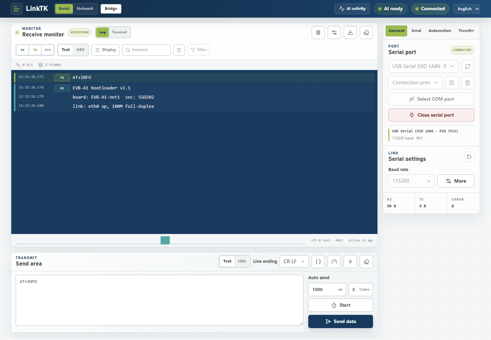
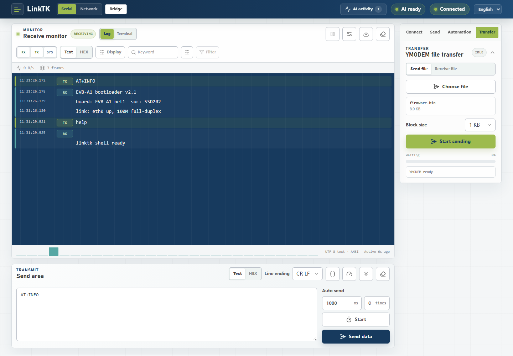
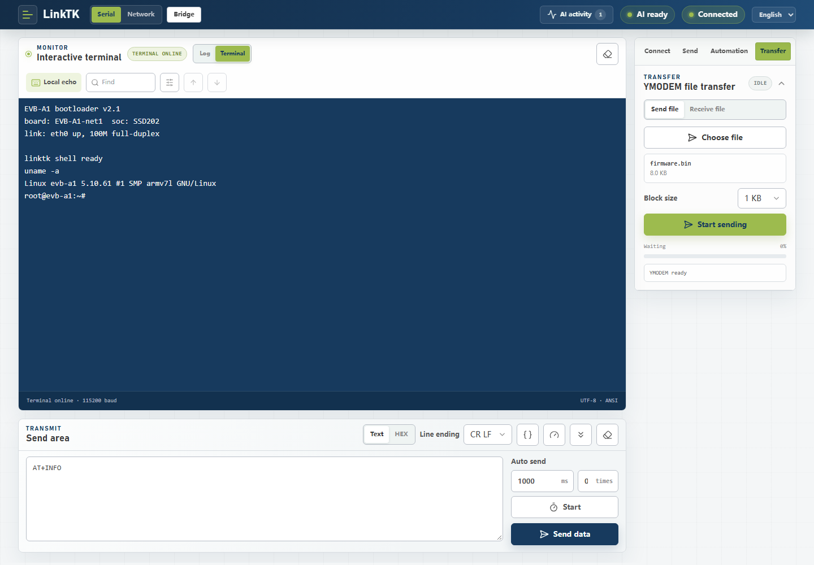
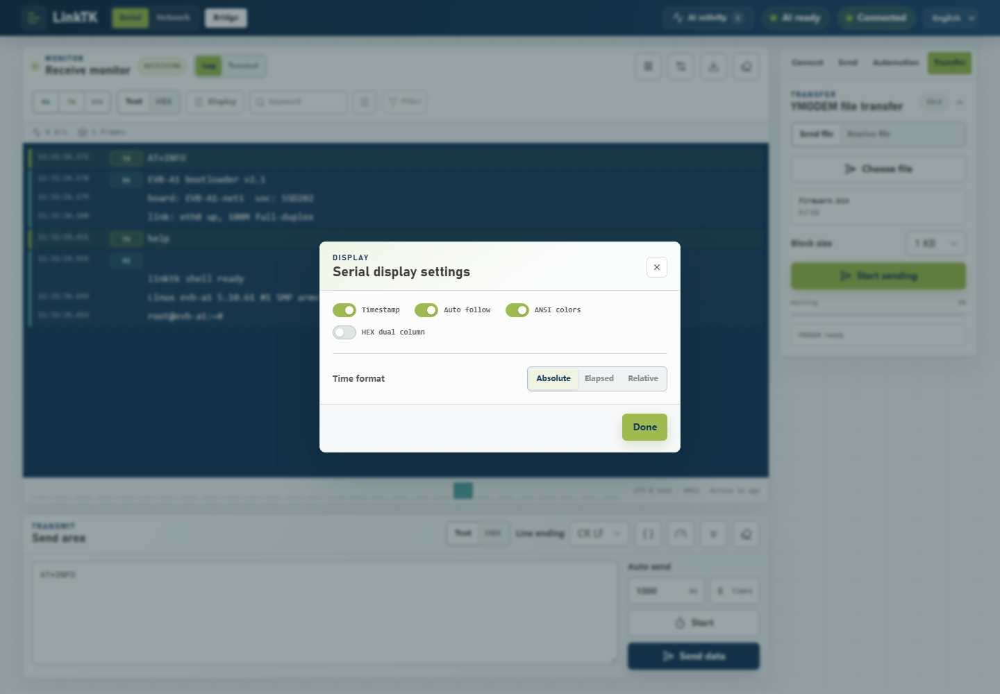
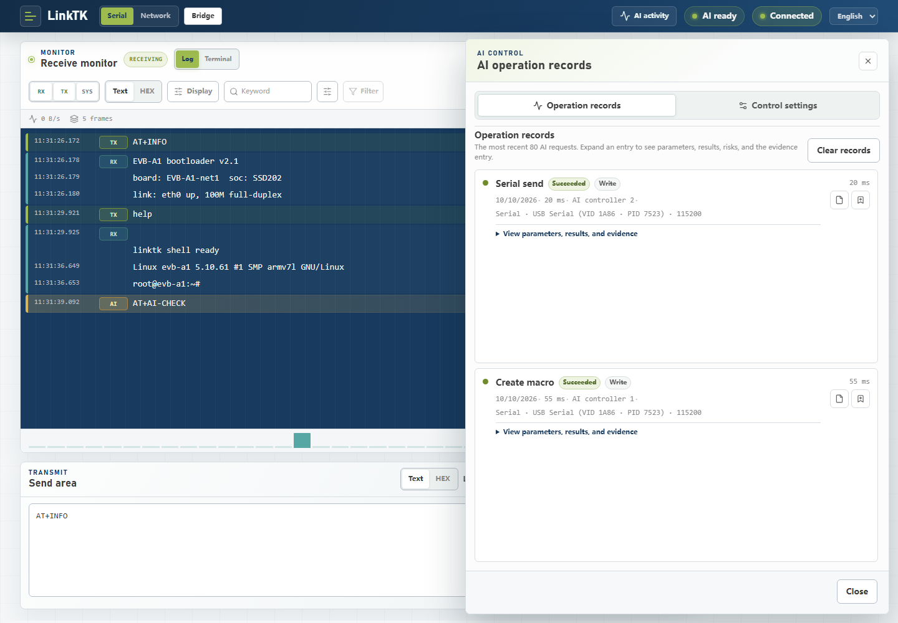
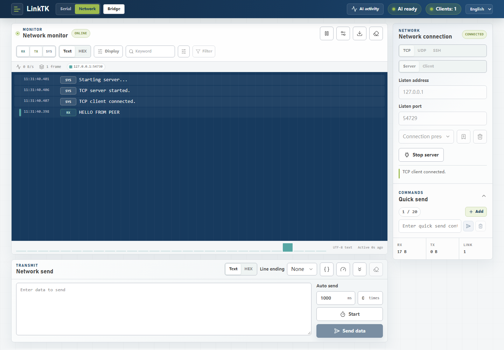
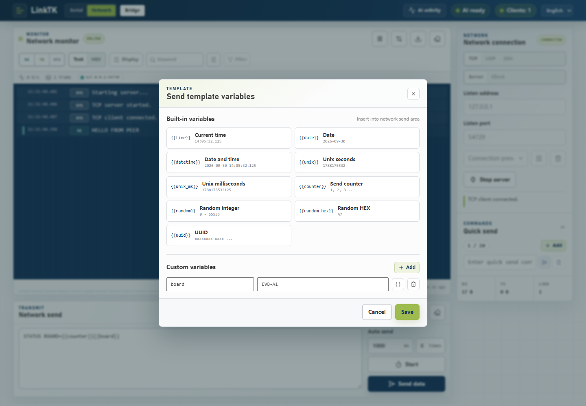
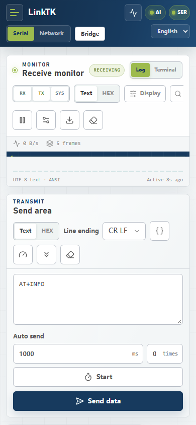

# LinkTK illustrated tutorial

This walkthrough goes from a fresh clone to AI-assisted debugging, using screenshots taken from the real UI (English). The same screenshots exist for the Chinese interface under `docs/images/zh-CN/`; the [Chinese edition](tutorial.zh-CN.md) uses them.

## 1. Start LinkTK

Double-click `start.bat` in the project root (Windows), or run:

```powershell
npm install
npm run dev
```

Then open `http://127.0.0.1:5173` in desktop Chrome or Edge. Web Serial needs a secure context: `localhost` and HTTPS work.

Requirements: Node.js 20 or later, desktop Chrome or Edge.

## 2. Connect a serial device



1. Open the **Connect** tab on the right and click **Select COM port** — the browser's system chooser appears and lists the serial devices.
2. Set the baud rate (here `115200`) and click **Open port**.
3. The badge next to the port title turns **CONNECTED**; the header shows the current state.

The receive area shows one merged block per direction: `TX` carries what you sent, `RX` what the device returned. The rate readout, the `2 frames` counter and the `RX 92 B / TX 9 B / ERROR 0` cards below update live.

## 3. Send data and quick-send commands


- Type in the **Send area** and press `Ctrl+Enter`, or click **Send data**.
- The **Send** tab holds a quick-send list: each row is a saved command with its own send button. Click the first row's send button to fire `help`; click **Add** to add a row.
- The list holds up to 20 entries; content and collapsed state are stored in the browser.

## 4. Record a macro


1. Open the **Automation** tab and click **Start recording**.
2. Perform the sequence once — in log mode every send becomes a step, in terminal mode each Enter-terminated command becomes one step.
3. Stop recording, name the macro, and it appears in the list with its step count and delays (`1 step · 500 ms command · …`).

Click the play button on a macro to replay it; the pencil icon edits steps, intervals and delays. Macros can also be created and run from the AI control channel.

## 5. Transfer files with YMODEM



1. Open the **Transfer** tab.
2. Click the file drop area (or drop a file there) to queue, for example, `firmware.bin`.
3. Press **Start sending**; progress, speed and the remaining time appear in the panel. Switch to **Receive** to save a file the device sends.

The protocol uses CRC16-XMODEM with 1 KB blocks by default (128 B switchable), timeout retransmission and full EOT/batch-end handling.

## 6. Use the terminal



Switch **Log / Terminal** above the console. Terminal mode is a real xterm.js shell: keystrokes go straight to the serial port, with arrow keys, backspace, Tab, `Ctrl+C` / `Ctrl+D`, ANSI cursor control and history. The screenshot shows `uname -a` typed with **Local echo** on (needed when the device does not echo by itself). The keyword box in the terminal toolbar searches, highlights and jumps through the scrollback.

## 7. Tune the display



The **Display** button opens the display dialog: timestamps, follow mode, ANSI colors, the time format (**Absolute** / **Elapsed** / **Relative**), dual-column HEX with ASCII/text preview, and RX/TX/SYS direction toggles for the toolbar.

## 8. Let an AI drive — and approve its writes



LinkTK exposes a local AI control channel: an agent connects through the Agent CLI or the bundled MCP server and operates the page you already have open — it never opens a second serial or network connection.

1. The badge on **AI activity** counts unread operations; the panel shows the operation list with parameters, results and status.
2. With the default policy **Writes require confirmation**, every AI write (send, command execution, SFTP change) opens a confirmation dialog with a countdown; **Allow** executes, **Deny** is final.
3. The **Control settings** tab holds the approval policy, pause/cancel controls, device profiles and task templates.

Setup, the full CLI/MCP reference and troubleshooting live in [`AI_AGENT.md`](AI_AGENT.md).

## 9. The network workspace: run a TCP server



Switch **Serial / Network** in the top bar, then pick **TCP** and **Server**, choose a port, and connect. The listener is a real TCP server bridged through the local dev service; the screenshot shows a client (`127.0.0.1`) connected, the **1** link counter, and the peer's `HELLO FROM PEER` line in the log with its stable peer color. Sends broadcast to every connected client. UDP server/client and SSH terminal live in the same workspace.

## 10. Template variables in the send area



Any send area resolves `{{name}}` before sending. The **{}** button opens the **Send template variables** dialog: built-in variables cover time, date, Unix time, send count, random number, random HEX and UUID; add custom name/value pairs here (the example defines `board = EVB-A1`) and insert the value or the `{{counter}}` token into the send box. Variables are re-resolved on every timed-send tick, and a leading `\` sends a literal `{{name}}`.

## 11. Switch language


The top bar has an interface language selector. English is the default on first run; choosing **中文** switches every label, badge, dialog and runtime message immediately — no reload — and the choice is remembered for the next visit.

## 12. Small screens



The layout reflows down to a 390 px viewport: panels stack, toolbars wrap, and the same serial, network and AI features stay available. Web Serial itself still requires a desktop browser, so treat this as a companion view rather than a phone workflow.
