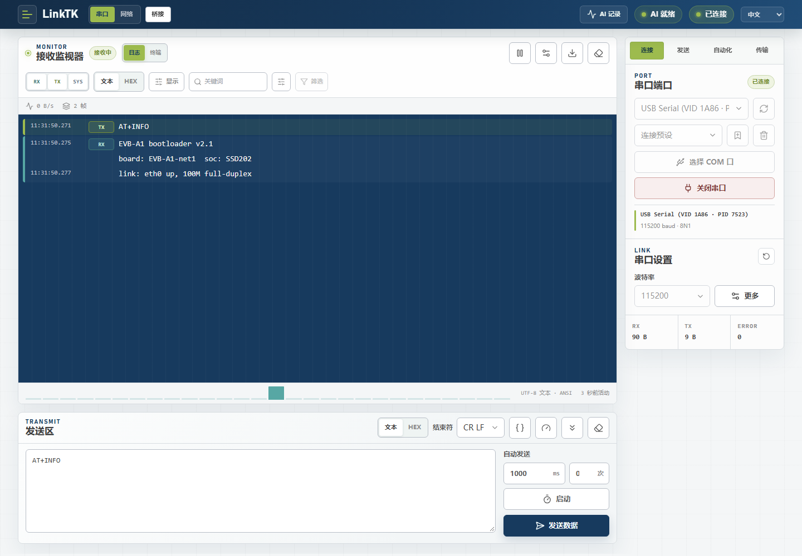
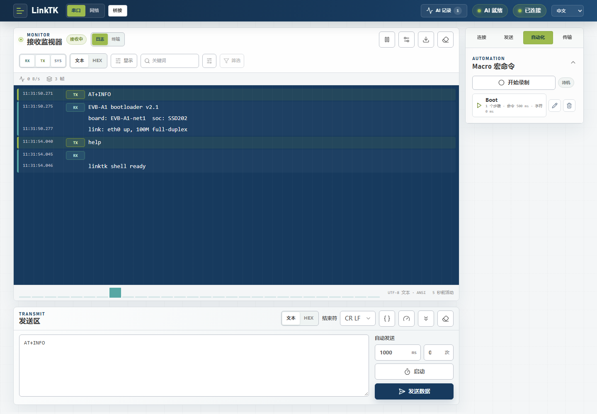
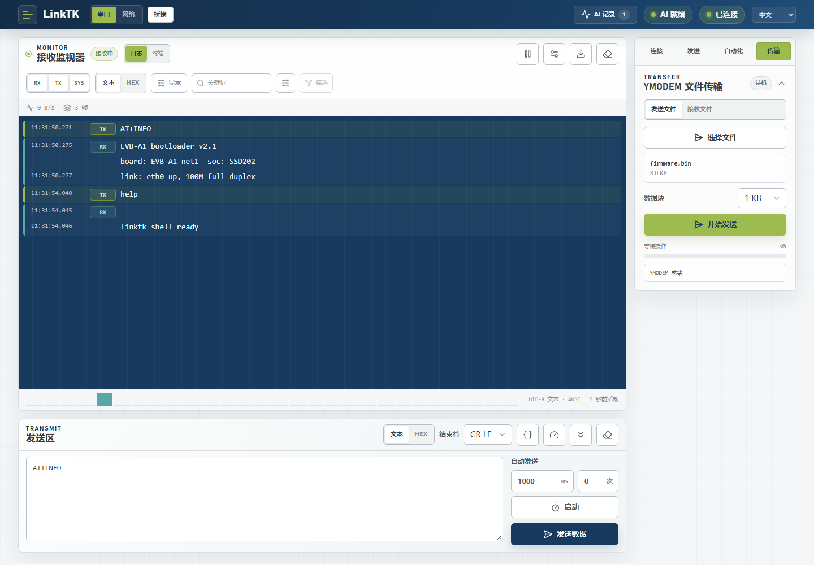
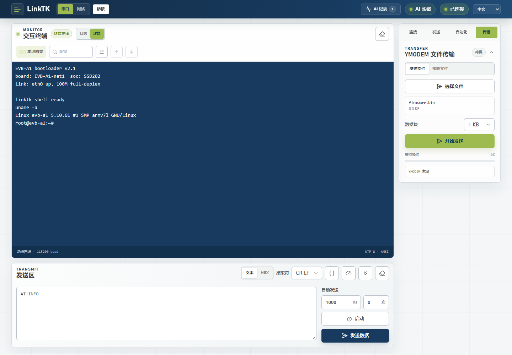
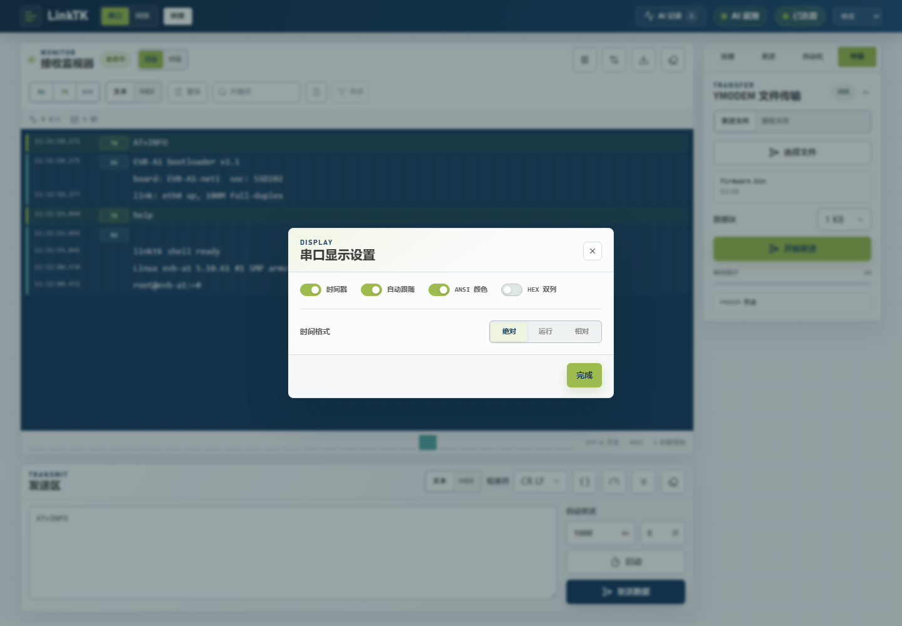
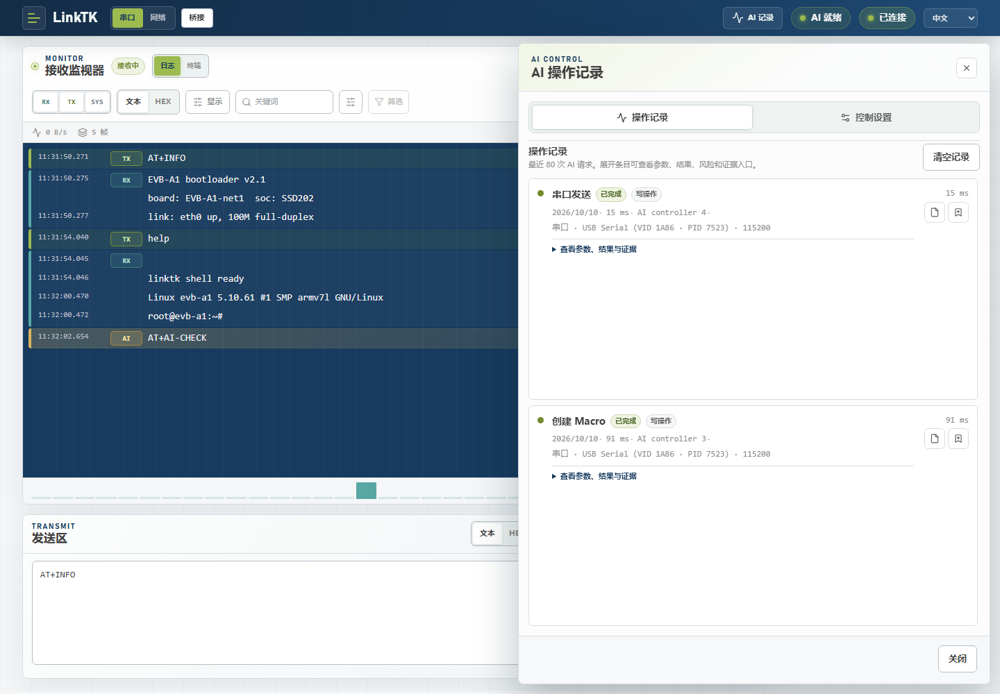
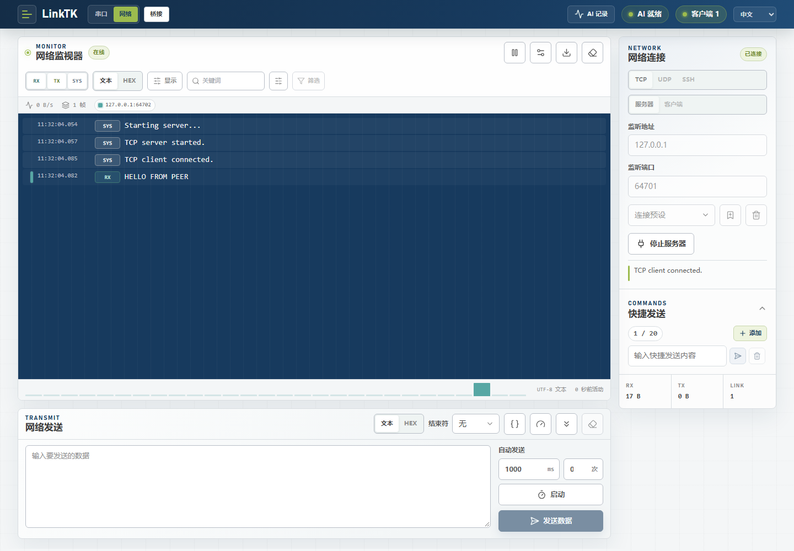
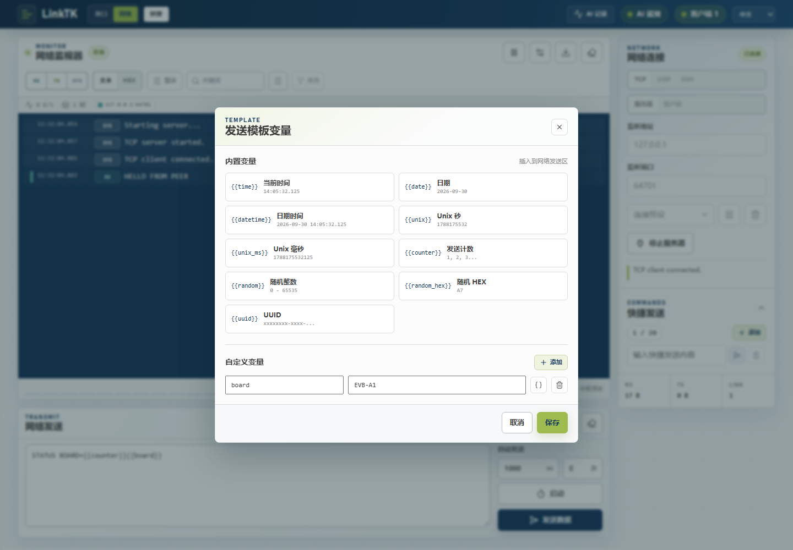
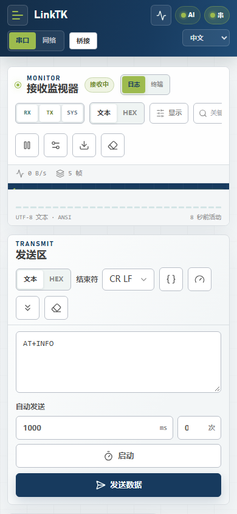

# LinkTK 图文教程

本教程用真实界面截图带你从零跑通到 AI 辅助调试。以下为中文界面截图；文中步骤在英文界面下完全相同（截图另见 `docs/images/en/`，英文版教程为 [tutorial.md](tutorial.md)）。

## 1. 启动 LinkTK

Windows 下双击项目根目录的 `start.bat`，或命令行启动：

```powershell
npm install
npm run dev
```

然后在桌面版 Chrome 或 Edge 打开 `http://127.0.0.1:5173`。Web Serial 需要安全上下文，`localhost` 与 HTTPS 可用。

依赖：Node.js 20 及以上，桌面版 Chrome 或 Edge。

## 2. 连接串口设备



1. 右侧打开 **连接** 页，点 **选择 COM 口**，在弹出的系统选择器里选串口设备。
2. 设置波特率（图中为 `115200`），点 **打开串口**。
3. 端口标题旁变为 **已连接**，顶栏同步显示当前状态。

接收区按方向合并显示：标 `TX` 的是你发出的，标 `RX` 的是设备返回的。上方速率读数、`2 帧` 计数，下方 `RX 92 B / TX 9 B / 错误 0` 统计卡实时更新。

## 3. 发送数据与快捷发送


- 在 **发送区** 输入后按 `Ctrl+Enter` 或点 **发送数据**。
- **发送** 页里是快捷发送列表：每行一条命令、各自带发送按钮，点第一行的发送按钮即可发出 `help`；点 **添加** 新增一行。
- 列表最多 20 条，内容与折叠状态都保存在浏览器里。

## 4. 录制 Macro



1. 打开 **自动化** 页，点 **开始录制**。
2. 正常操作一遍：日志模式下每次发送记为一个步骤，终端模式下每条回车分隔的命令记为一个步骤。
3. 停止录制并命名，Macro 即出现在列表中，带步骤数与间隔信息（`1 step · 500 ms command · …`，中文界面为「1 个步骤 · 命令 500 ms · 字符 …」）。

点播放按钮回放，点铅笔图标可编辑步骤、命令间隔与字符间隔。Macro 也可通过 AI 控制通道创建与回放。

## 5. 用 YMODEM 传文件



1. 打开 **传输** 页。
2. 点击文件选择区（或把文件拖进去）选中固件等文件，如图中的 `firmware.bin`。
3. 点 **开始发送**，面板显示进度、速率与剩余时间；切到 **接收** 可把设备发来的文件保存到本地。

协议为 CRC16-XMODEM，默认 1 KB 块（可切 128 B），带超时重传与完整的 EOT / 批次结束处理。

## 6. 使用终端



在控制台上方切换 **日志 / 终端**。终端模式是真正的 xterm.js shell：按键直达串口，支持方向键、退格、Tab、`Ctrl+C` / `Ctrl+D`、ANSI 光标控制与历史记录。图中为开启 **本地回显**（设备自身不回显时需要）后输入 `uname -a` 的结果。终端工具栏的关键字框可对回滚区搜索、高亮与跳转。

## 7. 调整显示设置



点 **显示** 打开显示设置：时间戳、跟随、ANSI 颜色、时间格式（**绝对** / **运行** / **相对**）、HEX 双栏（文字对照 / ASCII 预览），以及工具栏的 RX/TX/SYS 方向开关。

## 8. 让 AI 操作，并批准它的写操作



LinkTK 内置本地 AI 控制通道：AI 通过 Agent CLI 或随附的 MCP server 操作你已打开的页面，不会另开第二个串口或网络连接。

1. **AI 活动** 按钮上的角标是未读操作数；面板里逐条列出操作、参数、结果与状态。
2. 默认策略为 **写操作需确认**：AI 每次写（发送、执行命令、SFTP 变更）都会弹确认框并带倒计时，点 **允许** 才执行，**拒绝** 即终局。
3. **控制设置** 页里可改审批策略、暂停 / 取消 AI，维护设备 Profile 与任务模板。

接入方式、完整 CLI/MCP 参考与排障见 [`AI_AGENT.md`](AI_AGENT.md)。

## 9. 网络工作区：起一个 TCP 服务端



顶栏切到 **网络**，选 **TCP** 和 **服务器**，填端口后连接。服务端是经本地服务桥接的真实 TCP 监听；图中已有一个客户端（`127.0.0.1`）连入，链路计数为 **1**，日志里能看到对端的 `HELLO FROM PEER` 与其固定对端色标。发送内容会广播给所有已连接客户端。UDP 服务端/客户端与 SSH 终端也在同一工作区。

## 10. 发送区的模板变量



所有发送区在实际发送前都会解析 `{{名称}}`。点 **{}** 打开 **发送模板变量**：内置变量覆盖时间、日期、Unix 时间、发送次数、随机数、随机 HEX 与 UUID；可在此新增自定义名值对（图中定义了 `board = EVB-A1`），并把变量值或 `{{counter}}` 标记插入发送框。定时发送每次触发都会重新解析；以 `\` 开头可发送字面量 `{{名称}}`。

## 11. 切换语言


顶栏有界面语言选择器。首次使用默认英文；选 **中文** 后所有标签、角标、弹窗与运行时提示立即切换（无需刷新），且会被记住。

## 12. 窄窗口



窗口收窄到 390 px 时布局自动重排：面板堆叠、工具栏换行，串口、网络与 AI 功能都保留。Web Serial 本身仍要求桌面浏览器，窄窗口适合作为副窗口使用。
